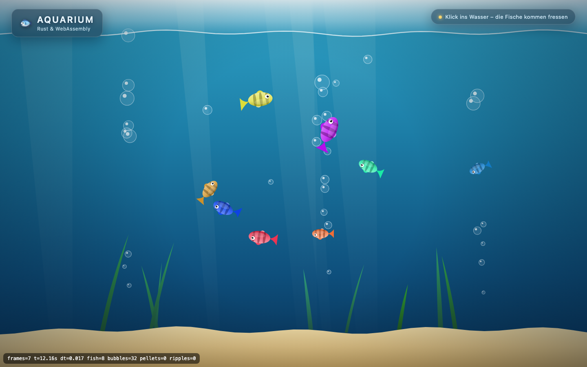

# 🐠 Aquarium

Eine interaktive Aquarium-Webapplikation in **Rust** und **WebAssembly**.

Die Fische schwimmen frei durch das Wasser, Blasen steigen auf, Sonnenstrahlen
schalten sich langsam durch das Wasser – und bei einem Klick irgendwo ins Wasser
streuest du Futter. Die Fische kommen herbei und fressen.



## Features

- 🐟 8 Fische mit individuellen Farben, Geschwindigkeiten und Sprunghöhen
- 🫧 Blasen von Luftventilen und aus den Fischmündern
- 🌿 Schwingende Seetangpflanzen, Sandgrund und sanft bewegte Wasseroberfläche
- ☀️ Sanft pulsierende Sonnenstrahlen
- 🍽️ Klick ins Wasser → Futter wird gestreut, die Fische stürmen herbei und fressen
- 📱 Responsiv, passt sich dem Fenster an

## Bauen & Ausführen

Voraussetzung: [Rust](https://rustup.rs/) mit `wasm32-unknown-unknown` Target
und [wasm-pack](https://rustwasm.github.io/wasm-pack/).

```sh
rustup target add wasm32-unknown-unknown
cargo install wasm-pack   # oder: npm install -g wasm-pack

# wasm bauen (erzeugt pkg/)
wasm-pack build --target web --release

# lokal servieren
python3 -m http.server 8000
# → http://localhost:8000
```

Alternativ einfach `index.html` mit einem statischen Server öffnen
(ES-Module erfordern einen Server, `file://` funktioniert nicht).

## Steuerung

**Klick / Tippen** irgendwo ins Wasser – das Futter wird dort gestreut und
die Fische kommen es fressen.

## URL-Parameter (Entwicklung/Demo)

| Parameter | Beschreibung |
|-----------|--------------|
| `?demo=1` | Streut nach 1,5 s automatisch Futter (zum Testen) |
| `?ff=N`   | Simuliert N Sekunden direkt beim Laden |
| `?debug=1` | Zeigt einen Debug-Overlay (Frames, Sim-Zeit, Zählungen) |

Beispiel: `index.html?demo=1&ff=4&debug=1`

## Projektstruktur

```
index.html      # Seite + HUD
src/lib.rs      # komplette App (Logik, Physik, Rendering, WASM-Bootstrap)
pkg/            # gebaute WASM-Artefakte (von wasm-pack erzeugt)
```

## Technik

- Rust + `wasm-bindgen` + `web-sys` (Canvas 2D Rendering)
- Keine externen JS-Abhängigkeiten; die App läuft komplett in WASM
- Physik/Verhalten: eigene einfache Steering-Logik (Wandering, Begrenzung,
  Futter-Attraktion), keine Physik-Engine
